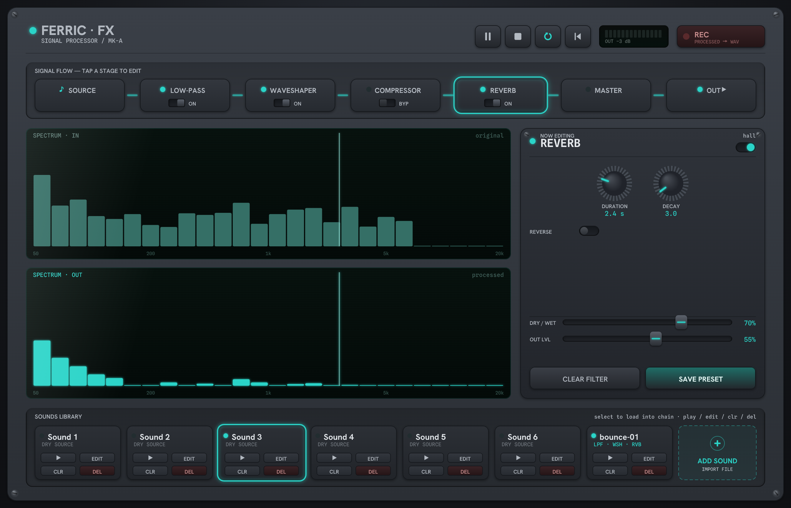
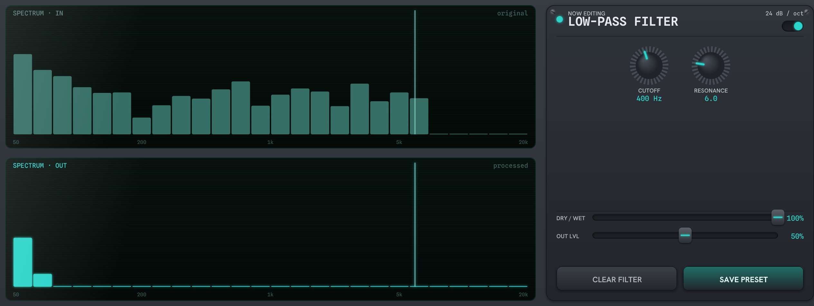
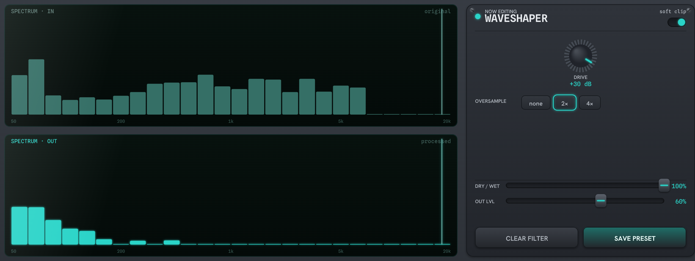
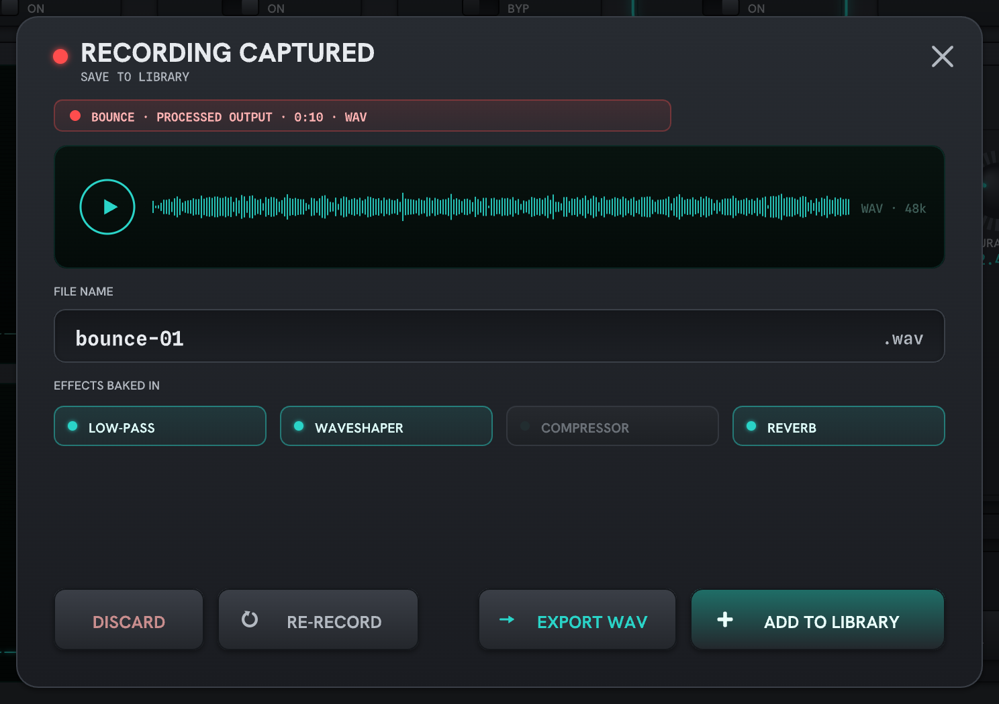

# The application

Ferric FX is a web audio application built with p5.js and its p5.sound
library. A pre-recorded sound file plays through a fixed processing
chain (low-pass filter, waveshaper distortion, dynamic compressor,
reverb and master volume); the result is sent to the output device,
recorded to a WAV file, or saved into a sounds library.

The chain is built once at start-up in `audioEngine.js`. Every p5.sound
effect auto-connects to the speakers, so each node is first
`disconnect()`ed and then wired in series (`source → p5.LowPass →
p5.Distortion → p5.Compressor → p5.Reverb → p5.Gain → output`), the
fixed signal flow shown in Figure 2. Two `p5.FFT` analysers tap the
chain's head and tail to draw the *Spectrum In* and *Spectrum Out*
displays, so every edit is immediately visible. Transport buttons
(play/pause, stop, loop, skip to start) drive the current
`p5.SoundFile`.

{width=88%}

```{=latex}
\begin{figure*}[b]
\noindent\sbox0{%
\begin{tikzpicture}[
  font=\scriptsize,
  >={Stealth[length=4pt,width=4pt]},
  box/.style={draw=black!55, line width=0.5pt, rounded corners=2pt,
              fill=black!4, text width=15mm, align=center,
              minimum height=9mm, inner sep=2pt},
  arr/.style={->, draw=black!55, line width=0.5pt},
  node distance=4mm,
]
  \node[box] (src) {Sound\\File};
  \node[box, right=of src] (lpf) {Low-Pass\\Filter};
  \node[box, right=of lpf] (wsh) {Waveshaper\\Distortion};
  \node[box, right=of wsh] (cmp) {Dynamic\\Compressor};
  \node[box, right=of cmp] (rev) {Reverb};
  \node[box, right=of rev] (mst) {Master\\Volume};
  \coordinate (out) at ($(mst.east)+(11mm,0)$);
  \foreach \a/\b in {src/lpf,lpf/wsh,wsh/cmp,cmp/rev,rev/mst}
    \draw[arr] (\a) -- (\b);
  \draw[arr] (mst.east) -- ($(out)-(3.5mm,0)$);
  \begin{scope}[shift={(out)}, line width=0.5pt, draw=black!70]
    \fill[black!70] (-2.4mm,-1.3mm) rectangle (-1mm,1.3mm);
    \fill[black!70] (-1mm,-1.3mm) -- (0.8mm,-2.6mm) -- (0.8mm,2.6mm) -- (-1mm,1.3mm) -- cycle;
    \draw (1.6mm,-1.7mm) arc (-42:42:2.3mm);
    \draw (2.5mm,-2.6mm) arc (-42:42:3.6mm);
  \end{scope}
\end{tikzpicture}}%
\usebox0
\par\medskip
\refstepcounter{figure}%
\noindent\parbox{\wd0}{\centering\footnotesize Figure~\thefigure: Internal
signal flow. A single fixed chain carries the source through the five
effect stages to the output device; \texttt{audioEngine.js} builds it
once and thereafter only pushes parameter changes into the live nodes.}
\end{figure*}
```

# The effects

*Low-pass filter* (`p5.LowPass`, via `freq()` and `res()`) attenuates
everything above its cutoff at 24 dB/oct, while resonance emphasises
the corner frequency. Figure 3 shows a broadband input reduced to its
lowest bands by a 400 Hz cutoff.



*Waveshaper distortion* (`p5.Distortion`, `set(amount, oversample)`)
pushes the signal through a nonlinear transfer curve. Unlike a filter
it creates new spectral content: harmonics of the input partials. In
Figure 4 the same filtered signal is driven hard and energy reappears
*above* the cutoff, generated entirely by the distortion. Oversampling
(2×/4×) tames the aliasing.



*Dynamic compressor* (`p5.Compressor`: threshold, ratio, knee, attack,
release) reduces dynamic range, adding no new frequencies; magnitudes
stay more constant over time, raising average loudness.

*Reverb* (`p5.Reverb`, `set(duration, decay, reverse)`) convolves the
signal with a decaying impulse response, smearing energy in time and
filling the gaps between transients: a denser, sustained spectrum.

*Master volume* (`p5.Gain`) scales the mix uniformly, so the spectrum
keeps its shape at a different level. Each stage also has DRY/WET and
OUT LVL faders; bypass is implemented as `drywet(0); amp(1)`, passing
the dry signal at unity so the graph never needs rewiring.

# Two enhanced filter options

A *feedback delay* (`p5.Delay`) would add echoes; at short delay times
the delayed copy interferes with the direct signal, carving comb-filter
notches spaced at 1/delay Hz across the spectrum.^[`p5.Delay`
reference: <https://p5js.org/reference/p5.sound/p5.Delay>. On the comb
filtering produced by short feedback delays, see J. O. Smith III,
*Physical Audio Signal Processing*, W3K Publishing, 2010, §"Feedback
Comb Filters".] A *multi-band equaliser* (`p5.EQ`) would allow surgical
boosts and cuts at chosen frequencies rather than the low-pass's single
downward slope.^[`p5.EQ` reference:
<https://p5js.org/reference/p5.sound/p5.EQ>. Equaliser and filter
effect design is treated in J. D. Reiss and A. P. McPherson, *Audio
Effects: Theory, Implementation and Application*, CRC Press, 2015.]
Both are p5.sound nodes that could be patched into the chain unchanged.

# The sounds library

Six pre-recorded WAVs load into the library panel at start-up.
Selecting a card loads it into the chain; EDIT opens its stored effect
configuration in the editor, CLR resets it to a dry source, DEL removes
it. REC records the processed master bus with `p5.SoundRecorder`;
stopping opens the capture dialog (Figure 5) where the take can be
auditioned, renamed, exported as a WAV via `save()`, or added to the
library with its effect settings baked in.



The new card lists its stored effects (`LPF · WSH · RVB`, Figure 6).
SAVE PRESET persists the live settings; the library index lives in
`localStorage` and recorded or imported audio in IndexedDB, so sounds
*and* their effect configurations survive a reload to be re-edited,
cleared or deleted later.

```{=latex}
% Placed as a non-float: tufte-handout defers a trailing float to a lonely
% float page, so the strip is set inline with a hand-made margin caption.
\medskip
\refstepcounter{figure}
\noindent\marginnote{Figure~\thefigure: The library after saving:
\texttt{bounce-01} carries its baked-in effect chain.}%
\includegraphics[width=\linewidth]{figures/fig-library.png}
```

# Appendix: constructing the chain

How `audioEngine.js` builds the graph of Figure 2 once at start-up
(abridged):

    nodes = {
      lowpass:    new p5.LowPass(),
      waveshaper: new p5.Distortion(),
      compressor: new p5.Compressor(),
      reverb:     new p5.Reverb(),
      masterGain: new p5.Gain(),
    };
    // undo each effect's default route
    // to the speakers
    [nodes.lowpass, nodes.waveshaper,
     nodes.compressor, nodes.reverb]
      .forEach((n) => n.disconnect());
    // wire the fixed series chain
    nodes.lowpass.connect(nodes.waveshaper.input);
    nodes.waveshaper.connect(nodes.compressor.input);
    nodes.compressor.connect(nodes.reverb.input);
    nodes.reverb.connect(nodes.masterGain.input);
    nodes.masterGain.connect(); // -> output device

    fftIn = new p5.FFT();  // Spectrum In: the source
    fftOut = new p5.FFT(); // Spectrum Out: post-FX
    fftOut.setInput(nodes.masterGain);
    recorder = new p5.SoundRecorder();
    recorder.setInput(nodes.masterGain); // REC taps here
